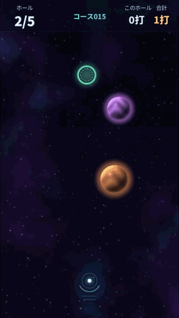
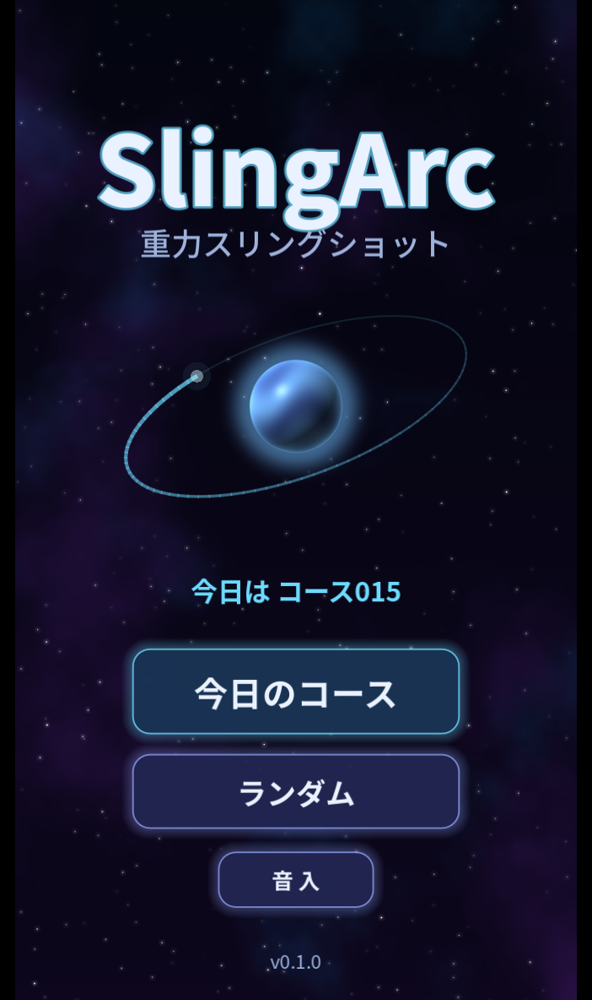
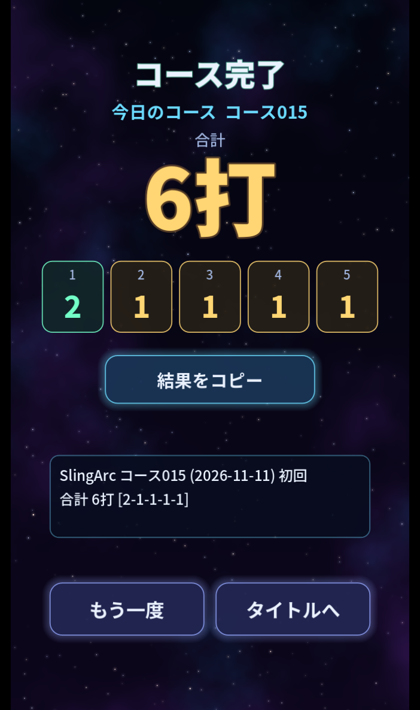

# SlingArc

惑星の重力で軌道を曲げて、探査機をゴールに入れる。ブラウザで開くだけで遊べる 2D ゲームです。5 ホールで 1 コース、合計の打数が少ないほど良い。

**▶ 遊ぶ: https://takosasi-dev.github.io/sling-arc/** (デスクトップの Chrome・Edge・Firefox。インストール不要)

<p align="center">
  
</p>

> v0.1.1。引っ張りの強さや予測線の長さなどの調整値は、まだ人に遊んでもらって決めた値ではありません。

## 遊び方

- 画面のどこでも押して引っ張り、離すと、**引いた向きの反対**へ探査機を撃ちます。長く引くほど強い。
- 引っ張っている間は、少し先までの予測線が出ます。その先は撃ってみないと分かりません。
- 惑星は探査機を引き寄せます。**大きい星ほど強く曲がります**。ぶつかったら外れです。
- 外れた軌道と前回の矢印は画面に残ります。前の 1 発を見て「もう少し左」と撃ち直してください。
- 飛んでいる間に画面を押し続けると早送り。
- 1 ホール 9 打まで。入らなければ 10 打として次のホールへ進みます。
- 初めて開いたときは、練習の 2 ホールが先に出ます(スキップできます)。

## 今日のコース

「今日のコース」は日付で決まり、同じ日なら誰でも同じ 5 ホールです(100 本を順に回ります)。結果画面の文字をコピーして貼れば、打数を比べられます。

```
SlingArc コース015 (2026-11-11) 初回
合計 6打 [2-1-1-1-1]
https://takosasi-dev.github.io/sling-arc/
```

「ランダム」は、今日以外のコースから 1 本を選びます。

<p>
  
  
</p>

## しくみ

- **軌道は自前の計算**です。Godot の物理エンジンは使わず、1/120 秒刻みで四則と平方根だけを決まった順番で計算します。端末やフレームレートが違っても、同じ引っ張りなら同じ軌道になります。Windows・Linux(CI)・ブラウザ(wasm)で同じ結果になることをテストで確かめています。
- **コースは作っておいた物**を同梱しています(`data/courses.json`)。どのホールも、決めた初速と、そこから縦横に ±5 ずらした 9 通りがすべて入ることを確かめた物だけです。
- 保存はブラウザの中だけです(練習を済ませたか・音の設定・日替わりの結果)。サーバーとの通信やアクセス解析はありません。シークレットモードでは保存されません。

## 動作環境

- Godot 4.7.2-stable(GDScript、レンダラー Compatibility)
- Web 書き出しはスレッド無し・拡張無し

## 開発

```
# テスト(全件成功で終了コード 0)
godot --headless --import
godot --headless --script res://tests/run_tests.gd

# Web 書き出し(書き出しテンプレート 4.7.2 が要る)
godot --headless --export-release "Web" build/web/index.html

# 書き出しを窓の出ない Chrome・Edge で開いて、保存を確かめる(Node.js 22 以上と Python が要る)
node tests/web_storage.mjs

# コースを作り直す(data/courses.json を上書き。約 7 分)
godot --headless --script res://tools/gen_courses.gd

# 効果音を作り直す(assets/sfx/*.wav)
python tools/gen_sfx.py
```

`main` に push すると、GitHub Actions(`.github/workflows/pages.yml`)がテスト・Web 書き出し・GitHub Pages への配置を行います。テストが落ちたら配置しません。書き出し結果(`build/`)はコミットしません。変更の記録は [CHANGELOG.md](CHANGELOG.md)。

## ライセンス

コードは [MIT](LICENSE)。効果音は `tools/gen_sfx.py` で作った自作です。同梱フォント(Noto Sans JP)は SIL Open Font License 1.1 です。詳しくは [THIRD-PARTY-NOTICES.md](THIRD-PARTY-NOTICES.md)。
